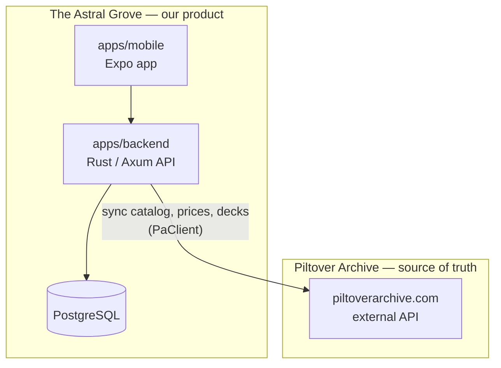
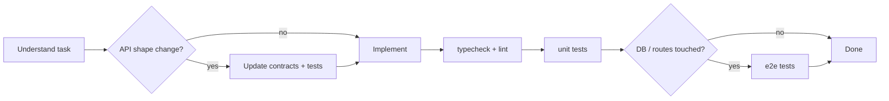

# Agent instructions — The Astral Grove

> **The Astral Grove** is our product: a fast Riftbound companion app for managing your collection and building decks.
> [**Piltover Archive**](https://piltoverarchive.com) is the upstream source of truth for card data, prices, and community decks — we are a separate product that sits on top of it, not a reskin of their site.
>
> Read this file first. For mobile UI work, also read [`apps/mobile/AGENTS.md`](apps/mobile/AGENTS.md), [`apps/mobile/PRODUCT.md`](apps/mobile/PRODUCT.md), and [`apps/mobile/DESIGN.md`](apps/mobile/DESIGN.md).

---

## What we build

The Astral Grove exists because listing and updating a collection on Piltover Archive can be slow. We optimize that workflow while still treating PA as authoritative for **what cards exist**, **what they cost**, and **what the community has published**.

### Product goals

| Area                 | What The Astral Grove does                                                 | Why it matters                                   |
| -------------------- | -------------------------------------------------------------------------- | ------------------------------------------------ |
| **Collection**       | Fast browse, add, remove, and quantity edits with local persistence        | Core daily-use flow — must feel snappier than PA |
| **Catalog & prices** | Cached card index, search, filters, Cardmarket price history               | Served from our DB after hash-based sync from PA |
| **Decks**            | Build and validate decks locally; browse community lists from PA           | Full deck builder with Riftbound legality rules  |
| **Deck import**      | Import PA deck text, browse PA decks, copy upstream decks into owned decks | Meet users where their data already lives        |
| **Accounts**         | Our own auth (Better Auth) and per-user data                               | Astral Grove users, not PA session passthrough   |

### What Piltover Archive owns (upstream)

PA remains source of truth for data we do not invent:

- Card catalog — sets, variants, rarities, images, legality metadata
- Price data — Cardmarket snapshots and history
- Community decks — public deck lists and detail payloads on piltoverarchive.com
- The **PiltoverArchive text format** for deck import/export (section headers like `Main Deck`, `Runes`, etc.)

Our API syncs this data into PostgreSQL (`sync-engine`, `card-cache`, `price-cache`) and re-serves it quickly. The mobile app **never** calls `piltoverarchive.com` directly.

### What The Astral Grove owns (our product)

| Data                     | Stored in                       | Notes                                                  |
| ------------------------ | ------------------------------- | ------------------------------------------------------ |
| User accounts & sessions | Postgres + Better Auth          | Independent from PA accounts                           |
| User collection          | `collection_items`              | Fast CRUD via `/api/v1/collection`                     |
| Owned decks              | `user_decks`                    | Editable copies; survives even if upstream write fails |
| Imported decks           | `user_decks` with `upstream_id` | Copied from a PA deck via `POST /decks/:id/import`     |
| Catalog & price cache    | Postgres                        | Refreshed from PA on hash change or cron               |

**Imported/upstream deck views are read-only.** Users edit by importing into an owned copy.

### Architecture at a glance



### Naming in this repo

The codebase uses several names — agents should understand the mapping:

| Name                              | Meaning                                                                                                                                                      |
| --------------------------------- | ------------------------------------------------------------------------------------------------------------------------------------------------------------ |
| **The Astral Grove**              | Product name (Expo app, user-facing copy)                                                                                                                    |
| **Piltover Archive / PA**         | Upstream card & deck platform we integrate with                                                                                                              |
| **`@riftbound/*` packages**       | Internal npm scope (historical codename — same monorepo)                                                                                                     |
| **`PA_API_KEY`, `PaClient`**      | Env vars and code for the **PA external API** client                                                                                                         |
| **`piltoverarchive` repo folder** | Git checkout path — not the product name                                                                                                                     |
| **`design/`**                     | Marketing site, separate from the Expo app                                                                                                                   |
| **EAS identifiers**               | Expo owner `astralgrove`, slug `astral-grove`, project `84e78cd9-68b6-4642-964f-2212b036d515`, scheme `astral-grove`, bundle/package `com.iroan.astralgrove` |

When writing user-facing copy, prefer **The Astral Grove**. When reading upstream integration code, expect **Piltover Archive** terminology in comments and deck I/O (`importPiltoverArchive`, `exportPiltoverArchive`).

---

## Repository map

| Path                            | Package                        | Role                                                                                                        |
| ------------------------------- | ------------------------------ | ----------------------------------------------------------------------------------------------------------- |
| `apps/mobile`                   | `@riftbound/mobile`            | **The Astral Grove app** — Expo SDK 57 (iOS, Android, Web), Expo Router, TanStack Query, tetra-ui + Uniwind |
| `apps/backend`                  | `@riftbound/api`               | Native Rust/Axum backend, PostgreSQL, Better Auth-compatible auth, PA sync                                  |
| `crates/astral-grove-api-types` | Rust DTO crate                 | Serde and OpenAPI wire types, independent from the database                                                 |
| `packages/api-contracts`        | `@riftbound/api-contracts`     | Generated OpenAPI and TypeScript wire types                                                                 |
| `tests/reference-api`           | `@riftbound/reference-api`     | Frozen Elysia oracle for regression comparison; never a production target                                   |
| `packages/contracts`            | `@riftbound/contracts`         | Shared Zod schemas + `z.infer` types for our API **and** PA payload shapes                                  |
| `packages/typescript-config`    | `@riftbound/typescript-config` | Shared strict TS config                                                                                     |
| `design/`                       | `astral-grove.com`             | Marketing / landing site (Next.js — not the mobile client)                                                  |
| `SPEC.md`                       | —                              | Architecture spec (may lag implementation — trust the code)                                                 |

**Data flow:** The Astral Grove mobile → our API → PostgreSQL → (sync) → Piltover Archive external API.

---

## Quality gate — run before finishing work

Agents **must** verify changes before marking a task complete. Run the narrowest scope that covers your edits, then widen if unsure.

```bash
# Full monorepo check (preferred before hand-off)
bun run check          # typecheck + lint + format:check
bun run test           # all package tests (starts Postgres if needed)

# Individual steps
bun run typecheck      # turbo typecheck (contracts build first)
bun run lint           # ESLint across apps + packages
bun run lint:fix       # auto-fix where possible
bun run format:check   # Prettier
bun run format         # write Prettier fixes
```

### Scoped commands

```bash
# Single package
bun run --cwd apps/backend typecheck
bun run --cwd apps/backend test
bun run --cwd apps/mobile typecheck
bun run --cwd apps/mobile test
bun run --cwd packages/contracts typecheck

# API: native Rust unit tests (no DB server)
bun run --cwd apps/backend test:unit

# API: native HTTP/Postgres tests (local fixtures and ephemeral ports)
bun run --cwd apps/backend test:e2e

# Mobile: one file
bun test apps/mobile/lib/deck-validation.test.ts

# Contracts: build required for dependents
bun run --cwd packages/contracts build
```

> **Do not skip checks** because a change “looks small.” Type errors in `contracts` propagate to API and mobile. E2E tests catch auth, DB, and route regressions that unit tests miss.

---

## Toolchain

| Tool           | Version / notes                                                        |
| -------------- | ---------------------------------------------------------------------- |
| **Runtime**    | [Bun](https://bun.sh) 1.4.2 (`packageManager` in root `package.json`)  |
| **Monorepo**   | Turborepo — tasks in `turbo.json`                                      |
| **Language**   | Rust 1.98.1 backend; strict TypeScript frontend/tooling                |
| **Validation** | Rust validators/Serde; shared Zod 3; generated OpenAPI type assertions |
| **API**        | Axum + Tokio + SeaORM PostgreSQL connection/transactions               |
| **Mobile**     | Expo 57, React 19, React Native New Architecture                       |
| **DB**         | PostgreSQL 16 (Docker Compose on port **5433**)                        |

Install dependencies from the repo root:

```bash
bun install
```

---

## Linting

Root ESLint config: `eslint.config.js` (typescript-eslint, recommended + project rules).

**Key rules agents must follow:**

- `consistent-type-imports` — use `import type { Foo }` for type-only imports
- `no-unused-vars` — prefix intentionally unused names with `_`
- Test files under `**/test/**` are ignored by root ESLint (API/mobile have their own test lint paths)

```bash
bun run lint                 # all workspaces
bun run lint:fix
bun run --cwd apps/mobile lint    # expo lint
cargo clippy --workspace --all-targets --locked -- -D warnings
```

**Prettier** (`prettier --check` / `--write`) covers `*.{ts,tsx,js,json,md}`. Match existing formatting; do not reformat unrelated files.

---

## Type checking

All packages use strict TypeScript. Shared base config enforces:

- `noUncheckedIndexedAccess`, `exactOptionalPropertyTypes`, `verbatimModuleSyntax`
- `noUnusedLocals`, `noUnusedParameters`

```bash
bun run typecheck    # turbo: builds ^dependencies first, then tsc --noEmit
```

**Mobile extras:**

- Path alias: `@/*` → `apps/mobile/*`
- After changing Uniwind/Tailwind tokens: `bun run --cwd apps/mobile uniwind:types`
- Test files are excluded from mobile `tsc` — they are still run by `bun test`

**Contracts:** changing a schema requires `bun run --cwd packages/contracts build` (or `turbo build`) so `dist/` types update for API/mobile imports.

---

## Zod & `@riftbound/contracts`

Zod is the **contract layer** between API, mobile, and upstream payloads. Do not duplicate shapes as hand-written interfaces.

### Where schemas live

| Domain                           | File(s) in `packages/contracts/src/`                       |
| -------------------------------- | ---------------------------------------------------------- |
| HTTP responses / errors          | `api.ts`                                                   |
| Cards, catalog, pagination       | `cards.ts`                                                 |
| Prices                           | `prices.ts`                                                |
| Filters snapshot                 | `filters.ts`                                               |
| Collection + CSV                 | `collection.ts`, `collection-csv.ts`                       |
| Deck rules & validation          | `deck-rules.ts`                                            |
| Deck CRUD / list queries         | `decks.ts`                                                 |
| Upstream Piltover Archive shapes | `upstream.ts`                                              |
| Legality, variants, tags         | `card-legality.ts`, `variant-utils.ts`, `champion-tags.ts` |

Export new schemas from `packages/contracts/src/index.ts`.

### Patterns to follow

Rust owns backend wire DTOs and validators. Shared Zod owns frontend/upstream runtime validation. Keep them aligned; never infer correctness from generated types alone.

1. Update the Rust schema/DTO and shared Zod schema for a wire change.
2. Use `http::parse` / `http::value` on requests and `http::respond` on responses.
3. Run `cargo xtask openapi`, then `bun run --cwd packages/contracts build`.
4. Keep the 135 bidirectional assertions in `rust-type-alignment.ts` passing.
5. Extend runtime differential and HTTP tests for coercion, defaults and boundaries.
6. Mobile clients must keep parsing every response with the contract schema.

Do not hand-edit generated `packages/api-contracts/src/schema.ts`, duplicate wire types, or bypass external JSON validation with casts. The generated checker must not edit files, read environment files, or connect to a database.

## Testing

`bun run test` orchestrates local PostgreSQL and the workspace suites. Rust unit tests use `cargo test`; HTTP, compatibility, mobile and shared tests use Bun.

| Tier          | Command                                                                   | Evidence                                                                          |
| ------------- | ------------------------------------------------------------------------- | --------------------------------------------------------------------------------- |
| Native unit   | `cargo test --workspace --locked`                                         | Pure Rust semantics, caches, validators, passwords, SSE                           |
| Native HTTP   | `bun run --cwd apps/backend test:e2e`                                     | Rust process + local PostgreSQL, PA/Cardmarket, JMAP and S3 fixtures              |
| Compatibility | `bun run --cwd apps/backend test:compat`                                  | Original 219 e2e cases targeting Rust; some retain direct reference-service calls |
| Differential  | `bun run --cwd apps/backend test:parity`                                  | Shared/auth schemas, business rules and HTTP boundaries against the frozen oracle |
| Oracle unit   | `bun run --cwd tests/reference-api test`                                  | Original 398 cases plus baseline probes; not native coverage                      |
| Inventory     | `cargo xtask baseline`                                                    | Frozen source, all named functions, mounted routes and test dispositions          |
| Shared/mobile | `bun run --cwd packages/contracts test`, `bun run --cwd apps/mobile test` | Frontend schema and pure app behavior                                             |

`TEST_DB_URL` must name a loopback `riftbound_test` or `riftbound_test_*` database. Test code must never fall back to `DATABASE_URL`, load backend secrets, or contact live PA, mail or object storage. Keep test network fixtures deterministic. Native integration tests can target a packaged binary via `ASTRAL_BACKEND_BIN`.

The byte-pinned oracle source is under `tests/reference-api/src`; do not edit it to make Rust comparisons pass. Keep all 617 original case identifiers accounted for in `plans/rust-migration/test-destinations.tsv`. Retained TypeScript service tests are oracle evidence and must be reported separately from native evidence.

Add behavior tests for backend changes, preferably failing first. Native HTTP tests use unique synthetic emails and scoped cleanup. Mobile tests remain colocated Bun tests and should focus on behavior, not snapshots.

## Database & migrations

```bash
bun run db -d
bun run db:migrate
bun run db:down
```

**Agents must never run destructive database commands**, including on local or test databases. Forbidden: reset scripts, `DROP`, `TRUNCATE`, unscoped `DELETE`, or commands that wipe tables/databases. Use forward migrations and scoped test helpers. Ask before production data deletion.

- Native SQL: `apps/backend/migrations/`; registration: `apps/backend/src/migrations.rs`.
- The 16 original migrations and Drizzle ledger/checksums/timestamps remain compatible.
- Never edit applied SQL, discard historical ledger rows, reset, or reduce timestamp precision.
- For schema changes add a forward SQL file and increasing timestamp registration; apply locally and test fresh and repeated startup plus affected HTTP behavior.
- The frozen Drizzle schema/migrations are reference evidence, not a schema generator for the new backend.

## API conventions (`apps/backend`)

See [`apps/backend/README.md`](apps/backend/README.md) for the complete source map, CLI and development workflow.

- Axum handlers register with `OpenApiRouter` / `routes!`, with explicit unique operation IDs.
- Validate inputs and outputs using the central Rust schemas; preserve Zod stripping/coercion/default behavior.
- Parameterized SQL and transactions use `db.rs`; retain authorization and row/advisory locks around membership, sharing, deck versions and OTP consumption.
- Auth remains at `/api/auth/*` and compatible with existing Better Auth React/Expo clients, accounts, password hashes, signed cookies and bearer sessions.
- Mail, S3, PA and Cardmarket HTTP use bounded clients and validated payloads.
- Errors expose controlled public envelopes; log categories without raw tokens, credentials or request payloads.
- Use bounded caches/queues, release SSE permits on disconnect, and drain on SIGINT/SIGTERM. Current SSE deployment uses one replica.
- Production uses `Dockerfile.backend`; it must contain no TypeScript runtime/server.

```bash
bun run dev:api      # native watch/rebuild on port 7000
bun run dev:mobile   # unchanged Expo on port 7001
```

## Mobile conventions (`apps/mobile`)

See **[`apps/mobile/AGENTS.md`](apps/mobile/AGENTS.md)** for UI rules (tetra-ui, Uniwind, theming, component registry).

Highlights:

- **Expo Router** file-based routes under `app/`
- **TanStack Query** for server state; invalidate queries after mutations
- **API client:** `src/api/client.ts` — always parse responses with contract schemas
- **Deck logic:** `lib/deck-*` — validation rules should align with `packages/contracts/src/deck-rules.ts`
- **No direct Piltover Archive calls** — go through `EXPO_PUBLIC_API_URL`
- **Deck I/O:** `lib/deck-io.ts` — PiltoverArchive text import/export; align with PA community format

---

## Change workflow



1. **Read** relevant code and existing tests before editing
2. **Minimize scope** — match surrounding style; no drive-by refactors
3. **Rust and Zod contracts together** when the wire format changes
4. **Write or update tests first** when changing behavior, then implement to green
5. **Run checks** (see Quality gate)
6. **Do not commit** unless the user asks

---

## Code style

- **Rust** — snake_case functions/modules, PascalCase types, `cargo fmt`, and checked Clippy; use parameterized SQL.
- **TypeScript ES modules** — `import`/`export`, `.js` extensions in transpiled contracts/tooling.
- **Naming:** `camelCase` functions/vars, `PascalCase` types/components, `kebab-case` files in routes
- **Imports:** type-only imports separated (`import type`)
- **Comments:** only for non-obvious business rules, and keep each comment to one line
- **Errors:** prefer typed errors and contract validation messages over silent coercion
- **No secrets** in code — use `.env` (API) or `EXPO_PUBLIC_*` (mobile)

### Cleanup standards

- Keep Zod schemas composable and centralized with shared helpers instead of repeated inline primitives
- Add or extend backend unit tests for every cleanup or behavior change, and leave them passing
- Prefer TDD for contract, route, and service changes so failing expectations drive the refactor

---

## Do not

| Avoid                                                                                           | Do instead                                                                                      |
| ----------------------------------------------------------------------------------------------- | ----------------------------------------------------------------------------------------------- |
| Skip `bun run typecheck` / `lint` / tests                                                       | Run scoped checks at minimum                                                                    |
| Duplicate Zod shapes outside `contracts`                                                        | Use generated Rust types and shared Zod validation                                              |
| `any` or unchecked `as` on JSON                                                                 | `.parse()` / `.safeParse()`                                                                     |
| Call piltoverarchive.com from mobile                                                            | Use our API client                                                                              |
| Treat The Astral Grove as a PA fork or mirror                                                   | We are our own product; PA is upstream data only                                                |
| Edit imported/upstream decks in place                                                           | Import into an owned copy first                                                                 |
| `StyleSheet.create` / legacy theme in mobile                                                    | tetra-ui + Uniwind (see mobile AGENTS.md)                                                       |
| Edit generated contract output or an applied SQL migration                                      | Regenerate from source                                                                          |
| Force-push `main` or amend pushed commits                                                       | New commits unless user requests                                                                |
| Large unrelated formatting diffs                                                                | Keep PRs focused                                                                                |
| Destructive DB commands (`db:reset`, `DROP`, `TRUNCATE`, unscoped `DELETE`, `drizzle-kit drop`) | Forward migrations (`db:migrate`), scoped test cleanup only; ask user before prod-impacting ops |

---

## Reference docs

- [`SPEC.md`](SPEC.md) — product spec and architecture history
- [`apps/mobile/AGENTS.md`](apps/mobile/AGENTS.md) — Expo, tetra-ui, Uniwind
- [Expo SDK 57 docs](https://docs.expo.dev/versions/v57.0.0/)
- [Axum docs](https://docs.rs/axum/)
- [SeaORM docs](https://www.sea-ql.org/SeaORM/docs/)
- [Zod docs](https://zod.dev/)
