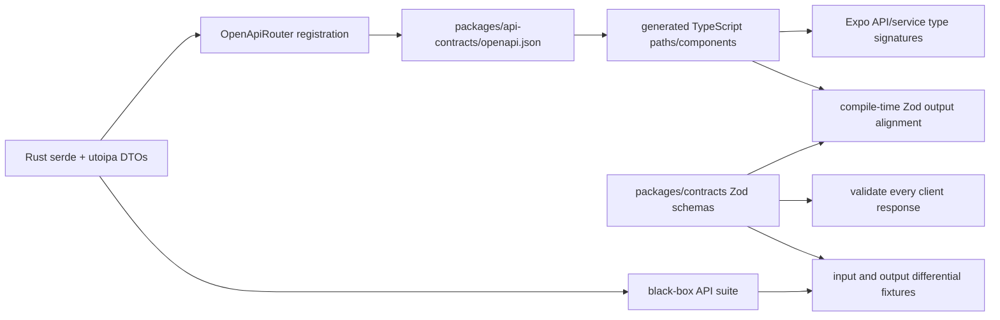

# Plan 001: Migrate The Astral Grove backend to Rust

Status: backend-only implementation on branch `rust-backend-rewrite`, based on `598a9189d8beb1222a789ed836d37754e4826001`. The production backend is now native Rust. Local acceptance evidence is maintained in [the validation report](rust-migration/local-validation.md). No deployment, commit, or traffic switch has been performed.

Scope: replace the entire Elysia/Bun backend, including authentication, with one Rust service. Keep the Expo application, its behavior, PostgreSQL, upstream integrations, and existing HTTP contracts. Follow Rocal's test-first migration sequence, with the Astral Grove differences below. Do not introduce a TypeScript auth bridge or claim a migration complete while any application endpoint still forwards to Elysia.

Source snapshots:

- Astral Grove: `598a9189d8beb1222a789ed836d37754e4826001` on `main`.
- Rocal: `b28edbe04e1ecccbe01ebf4e77b173f6d4a12a8e` on `master`.
- [Rocal implementation map](rust-migration/rocal-reference.md): original sequence, final implementation, reuse candidates, and lessons from later fixes.
- [Compatibility matrix](rust-migration/compatibility.md): domain behavior and verification requirements.
- [Local baseline](rust-migration/local-validation.md): commands actually run, results, confirmed defects, and unverified gates.
- [Machine-readable inventory](rust-migration/inventory.json): 55 application method/path operations and 40 mounted auth endpoint definitions, plus three server-only auth functions.
- [Test destinations](rust-migration/test-destinations.tsv): all 617 observed backend cases, including skips and the failing performance case. All dispositions are resolved. Original unit cases remain executable oracle cases; original e2e cases target native HTTP while retaining some direct reference DB/service checks. The checker verifies real case identifiers and JUnit execution counts, including parameterized cases and occurrences.

## Implementation decisions and final layout

The Rocal sequence was applied: pinned source/function/case inventories first; an isolated offline baseline; native auth interoperability; Rust schemas/OpenAPI/TypeScript generation; domain ports; concurrency and malformed-input probes; native startup, migration and container checks; tooling and documentation cutover. The sections below retain the detailed migration requirements and rollout recipe.

- Production: `apps/backend`, with DTOs in `crates/astral-grove-api-types`. No Elysia forwarding, TypeScript auth bridge or JS image processing runs in production.
- Reference: `tests/reference-api/src` is byte-identical to the pinned original 84 source files. Its tests remain a differential oracle and are excluded from the runtime image. All 516 named functions/methods were exercised; this is not branch or anonymous-callback coverage.
- Database: byte-identical SQL and the existing Drizzle ledger are owned by the native runner. Parameterized SeaORM/SQLx queries preserve PostgreSQL JSON, decimals and timestamp precision. The implementation deliberately uses explicit SQL rather than generating a second entity schema that could drift from the retained migration chain.
- Frontend: Expo source/behavior is unchanged. All 135 shared Zod output schemas have bidirectional compile-time assertions against Rust-generated types, with independent runtime differential cases.
- Development/maintenance: native watch/start/migrate/catalog sync/price sync/audit/retention/search EXPLAIN commands, root scripts and CI are migrated. Unsafe reset commands are retired. Pure release-publishing HMAC helpers live outside the retired server.
- Packaging: `Dockerfile.backend` builds the unprivileged Rust-only runtime. Backend IaC selects it; the mobile service configuration is unchanged. Existing ignored API environment files remain supported without moving or rewriting them.
- Intentional corrections: serialize collection bootstrap/invite acceptance, stop former members/revoked sessions from receiving private SSE events, include PATCH in CORS, and return controlled 4xx validation errors. These have explicit regression tests and are not silently counted as exact legacy parity.

The local task does not authorize a hosted deployment, external PA writes, real mail delivery, or production object-storage/database changes. Device/browser and hosted rollout/restore evidence remain separate gates before a later production switch.

## 1. Migration boundaries

The shipped API hostname, `/api/v1/*` paths, `/api/auth/*` behavior, collection ownership model, account IDs, session secrets, password hashes, and database contents survive the switch. A native binary must keep working without an update. Type-only frontend integration and contract-package changes belong in the migration; changes to screens, navigation, styling, collection UX, persisted mobile cache formats, and the marketing site do not.

PA remains the upstream catalog and community-deck authority. All mobile requests still go through our API. Port existing signed-printing synthesis and reconciliation as compatibility behavior; do not invent additional catalog behavior during the rewrite.

The production service must run as a Rust executable with no Bun, Node, Elysia, Better Auth server, Drizzle runtime, or Sharp process. Bun remains a build/test tool for Expo, TypeScript contracts, generated client types, and retained shared logic tests. Existing SQL migration history needs an explicit Rust owner before retiring Drizzle.

This plan is not a production deployment instruction. First finish the local gates, container validation, and concrete staging/cutover/rollback artifacts. Publishing the cutover and destructive resource retirement require the user's deployment scope at that time.

## 2. What to take from Rocal, and what to adapt

| Rocal mechanism                                           | Astral Grove application                                                                                                                            |
| --------------------------------------------------------- | --------------------------------------------------------------------------------------------------------------------------------------------------- |
| Safe local environment before any port                    | Loopback PostgreSQL 16, deterministic PA/Cardmarket/CDN/JMAP/S3 fakes, synthetic users and secrets, no production URL fallback                      |
| Existing-auth compatibility spike                         | Existing Better Auth 1.7.7 passwords, cookie and bearer sessions, Expo storage, email OTP and reset tokens; no passkeys or invite-gated signup here |
| Black-box suite against old backend first                 | Run the same suite against Elysia and Rust, checking HTTP, database state, audit writes, SSE, and outbound side effects                             |
| Separate Rust DTO crate, OpenAPI and generated TypeScript | Generate wire types for Expo and bind the retained Zod schemas to those types; preserve shared on-device logic                                      |
| Generated entities over existing schema                   | Generate from the committed fresh migration chain; account for known extra local history and preserve unknown tables                                |
| Boundary and malformed-input differential tests           | Compare Zod parsing/coercion, Unicode, timestamps/cursors, search ranking, CSV/TTS, prices, and deck validation                                     |
| Test deployment, benchmark and rollback drill             | First the locally built image; then an isolated backend test environment, keeping Expo's production service untouched                               |
| Stable hostname and recoverable release switch            | Preserve `riftapi.solace.onl`, cookie domain/secret, S3 keys and release URLs; retain a deployable TypeScript image until rollback is proved        |
| Cleanup only after cutover                                | Move migrations and backend tooling before deleting old source; update root scripts, CI, IaC and agent docs                                         |

Do not copy Rocal's defaults blindly. Astral Grove sessions last **7 days**, renew after **1 day**, and have **1 day** of freshness. Cookie caching is currently disabled. Password creation has a **12 UTF-16-unit minimum**, with the installed library's maximum of **128**. The intended application validation envelope is **422** with `{error:"VALIDATION_ERROR",message:"Request validation failed"}`. The later real-network boundary audit found that installed Elysia also returns detailed **500** responses on several routes; Rust intentionally corrects these to controlled 422 responses, as recorded in the validation report. Its ordinary Zod objects strip unknown fields; the Rust implementation must not blanket-reject them. Its database timestamps are `timestamptz(6)`, whereas Rocal's legacy timestamps were UTC `timestamp(3)` without a zone.

The current Rocal source already contains the post-review fixes for long fractional timestamps, `US/Pacific-New`, validator/OpenAPI nullability and integer agreement, missing `list-accounts`, and stale checker paths. Reuse current source and tests, not an older migration snapshot.

## 3. Acceptance principles

1. A route is ported only when the same black-box case passes on Rust, validates its response against the frontend's Zod schema, and verifies its data and side effects.
2. A generated type is evidence of compile-time alignment, not runtime validation. Independently probe the parser, validator, Serde DTO and OpenAPI document.
3. Data is not transformed merely because the language changes. Preserve IDs, decimals, timestamps, null/omitted distinctions, JSON payloads, hashes, foreign keys, indexes, triggers and migration history.
4. A protected request authenticates before application body validation, matching the current route factories. Malformed transport/body behavior is separately characterized against the installed Elysia version.
5. Existing security/data-integrity defects must be fixed deliberately, with named old/new expectations. The two reproduced collection races are mandatory fixes, not behavior to reproduce.
6. No tests or generators may inherit a production database, bucket, mail identity, endpoint, or secret from `.env`. Production-mode tests still use synthetic resources.
7. No `db:reset`, `DROP DATABASE`, `TRUNCATE`, unscoped `DELETE`, destructive cleanup, or schema reset. Use new test databases, forward migrations and scoped fixture cleanup. Keep local scratch databases for inspection.
8. No production claims from local source, local tests, configured IaC, mocked Expo native modules, or an image build. Report each evidence level separately.

## 4. Target architecture

Use Rust edition 2024 and a pinned toolchain. Start from Rocal's proven dependency family: Axum/Tokio, SeaORM 2.0.4 with SQLx/Postgres and rustls, Serde, utoipa with utoipa-axum, `time` for database timestamps, RustCrypto scrypt/HMAC/SHA-256, reqwest with rustls, `thiserror`, `tracing`, and a measured allocator. Pin the actual resolved versions in `Cargo.lock`; do not copy Rocal's lockfile wholesale. Authentication is implemented over the existing tables using the compatible primitives design, not an unproved generic Rust auth library.

Use SeaORM for schema-mapped CRUD and parameterized PostgreSQL SQL for search, cursor pagination, locking and price retention. Do not replace PostgreSQL search with a different search service. Keep one pool shared by auth, routes and background work. Preserve `DB_POOL_MAX`, SSL behavior and pool lifecycle. Disable SQL statement/value logging. Measure SQLx acquire checks and statement caching with the existing deployment topology rather than inheriting a hidden round trip on every query.

Proposed layout:

```text
Cargo.toml, Cargo.lock, rust-toolchain.toml
.cargo/config.toml                 # cargo xtask alias
apps/backend/
  Cargo.toml, Dockerfile
  src/main.rs, lib.rs              # serve, router and OpenAPI
  src/config.rs, state.rs, error.rs, telemetry.rs
  src/http.rs, http/               # guards, validated extractors, middleware
  src/auth.rs, auth/               # sessions, passwords, OTP, reset, cookies
  src/db.rs, db/                   # entities, behavior, migration runner
  src/catalog.rs, catalog/         # mapping, search, reconciliation, filters
  src/prices.rs, prices/
  src/collection.rs, collection/   # membership, mutations, import, audit, SSE
  src/sharing.rs, sharing/
  src/decks.rs, decks/             # owned, upstream, versions, validation
  src/settings.rs, wishlist.rs
  src/integrations.rs, integrations/ # PA, Cardmarket, CDN, S3, JMAP
  src/images.rs, releases.rs
  tests/unit.rs, tests/unit/       # mapped backend unit destinations
crates/astral-grove-api-types/      # wire DTOs: serde + utoipa only
crates/astral-grove-api-tests/      # black-box suite and differential goldens
xtask/                            # environment, migration, contracts, checks
packages/api-contracts/            # generated wire types, no runtime server
packages/contracts/                # retained Zod validation + shared app logic
retired/api/                       # only when the Rust cutover is validated
```

Keep domain handlers small: session/admin extractor, validated parameters, service call, typed response. Queries and transaction ownership belong in services. Do not expose generated database entities as API types. Split growing domains into `name.rs` plus `name/`; avoid a single catch-all handler and untyped JSON dispatch.

Workspace checks: rustfmt, clippy with warnings denied, `unsafe_code = forbid`, no production `unwrap`/`expect`/`todo!`/`dbg!`, structured redacted logs, bounded caches, timeouts, body limits, and graceful shutdown. Use `spawn_blocking` with two permits for scrypt and two bounded image workers; neither runs on Tokio request workers. Justify each dependency and do not add Solace-only mail, calendar, passkey, push or E2EE dependencies.

## 5. Frontend typing and validation

The final wire-type authority is the Rust DTO crate. Keep Zod as the frontend runtime validator and keep frontend/shared domain logic in TypeScript.



Implement `cargo xtask openapi [--check]` without opening a database or reading `.env`. Register routes and documentation together through `OpenApiRouter`/`routes!`; require unique explicit operation IDs. Document authentication, error variants, path/query parameters, CSV, SSE and binary responses, not only successful JSON DTOs. Compare actual mounted method/path pairs with the pinned inventory, including trailing-slash aliases and HEAD/OPTIONS behavior. Better Auth's former catch-all does not count as auth coverage: enumerate its 40 mounted endpoint definitions and classify each supported, disabled, or unsupported with an asserted response.

Generate TypeScript with `openapi-typescript`; expose `Schema<Name>` plus path/operation types. Update only `apps/mobile/src/api` and API-facing service signatures as needed. Keep response `.parse()` calls, auth cookie storage, cache ownership, local deck building, CSV/TTS helpers and all UI behavior. The Better Auth React/Expo clients remain protocol clients; their server library is not running in production.

Add strict TypeScript contract assertions in a dedicated package/check target. For every response, require structural equivalence between the generated wire type and `z.output<typeof Schema>`, including required nullable keys. For requests, distinguish the wire/input shape from normalized parser output: defaults, `z.coerce`, `.trim()` and boolean transforms make `z.input` and `z.output` different. A broad `unknown` input type is not an alignment proof. Test each explicit normalization and every omission/null/value case against Rust.

Rust request validation must implement the current semantics: unknown-key stripping, property defaults, union behavior, UTF-16 length limits, numeric coercion, exact query booleans, ISO dates, root body merging, and selected permissive transforms such as thumbnail width parsing. Do not use `as`, arbitrary `serde_json::Value`, or `Option<T>` everywhere to make an incompatible schema compile. Use named DTOs and a tri-state representation where omitted and null have different behavior. Validate upstream JSON before allowing it into typed services. Response-schema mistakes are server errors, not client 422s.

Keep the precise activity cursor as text with microseconds and UUID ordering. Normal UI timestamps still render like JavaScript `toISOString()` with three fractional digits. Deck timestamps are integer epoch **milliseconds**, not ISO strings or seconds. Rust integer widths must cover both JS-safe wire numbers and existing database values; accepted inputs must always deserialize successfully.

Port the pure deck rules and search/import helpers into Rust where the server needs them, retaining TypeScript implementations for the Expo client. Export golden fixtures from the current implementations and compare complete normalized outputs and error/message order in both languages. Do not move on-device behavior into network calls to avoid maintaining parity.

## 6. Execution sequence and gates

### Step 1 — Establish the safe baseline and migration owner

Before porting, snapshot the Git index/worktree state, re-check both source revisions, and regenerate/review inventories if either has drifted. Preserve unrelated changes. The graph MCP tools were not available in this session; discovery used source and runtime route introspection. Prefer the graph tools when they are available during implementation.

Build a local test environment with independent PostgreSQL 16 databases, a fake PA server, Cardmarket guide/product fixtures, CDN/image fixtures, an S3-compatible fake and a capturing JMAP fake. Disable real external delivery and upstream deck writes by construction. Provision explicit fake origins and synthetic credentials; do not merely rely on `NODE_ENV=test`. Keep all test URLs loopback-only initially and all object prefixes/run IDs unique.

Harden the existing harness before using `E2E_API_URL`: initialize the database assertion/cleanup context even when the server is external; reject missing or non-test `TEST_DB_URL`; refuse production API hosts/secrets; make cleanup failures visible; remove `.env` inheritance and live sync fallback. Characterize the current app in development and production modes using this harness. Its current default preload disables mail, so OTP/reset email flows need a second mail-enabled profile.

There are 16 source migrations, `0000` through `0015`. The existing local test DB has 17 history rows, all 16 known hashes match, and it retains an extra `card_art_fingerprints` table. A new scratch DB successfully applied exactly the 16 source migrations and has 23 public tables. Do not drop the extra table or rewrite the old history as part of this migration.

Implement a Rust migration runner that reads the existing Drizzle journal ordering, SQL statement boundaries, hashes and `drizzle.__drizzle_migrations` history, applies only pending SQL in a transaction, and serializes migration ownership with an advisory lock. Existing applied history must never be replayed. Preserve all known history hashes; classify additional historical entries rather than assuming a new blank ledger. Independently compare schema/constraints/indexes/triggers on a fresh database and an upgraded test copy. Keep the SQL files byte-identical. New migrations remain forward-only.

Test idempotent startup, concurrent startup, rollback after migration failure, safe retry, missing migration file, hash mismatch, unrelated extra history, permission failure, and startup refusal before serving traffic on an incompatible schema. Migration behavior must not depend on generated `dist/` or Bun's `import.meta.dir`.

**Exit gate:** deterministic tests run without production credentials or internet access; fresh and existing-history migration paths pass; the fixture cleanup and test-target guards are themselves tested. Record the latency failure and two confirmed races as named baseline exceptions until their Rust fixes pass.

### Step 2 — Prove auth interoperability before committing to the stack

Use the current TypeScript backend to write synthetic users, hashes, sessions, verification records and reset tokens into an isolated database. Keep its actual `BETTER_AUTH_SECRET`, cookie attributes and DTO formats for the fixture. Do not copy Rocal's 14-day session configuration, cookie-domain inference or passkey stack.

Prove both directions:

1. A TypeScript-issued session cookie authenticates on Rust, and a Rust-issued cookie authenticates on TypeScript, for development and Secure production names.
2. A TypeScript password hash verifies on Rust; Rust-created/changed/reset passwords verify on TypeScript. Use NFKC, scrypt `N=16384,r=16,p=1,dkLen=64`, and the **hex salt string** as salt; test Unicode and maximum-length boundaries.
3. The installed Better Auth React client and actual `@better-auth/expo/client` sign in, read/refresh a session, sign out, and handle every `Set-Cookie`. Native-module stubs count as protocol evidence; real iOS/Android builds remain a later device gate.
4. Cookie and bearer authentication preserve precedence, signed/raw token handling, encoding, `set-auth-token`, expiration, revocation, remember-me behavior and freshness requirements. Expired or revoked rows cannot be revived by a cached cookie.
5. Mail-enabled signup/sign-in require verification, existing grandfathered verified users still sign in, and mail-disabled local mode retains immediate sessions.
6. Email verification OTP, resend, email-change OTP, password change and reset work with the existing table representations and client error codes. OTP consumption must be atomic with bounded attempts and replay/concurrency tests. Preserve TTL and attempt state across a TS↔Rust rollback.
7. JMAP failures, bad credentials, missing config and delayed delivery produce the intended auth response, without leaking tokens/passwords/email content into logs. Use the capturing fake, then a dedicated real staging identity later.
8. Untrusted origins, malicious callback URLs, spoofed proxy headers, stale sessions, forged cookies and disabled auth capabilities receive the characterized responses.

The installed defaults are six-digit OTPs, 300-second OTP lifetime, three allowed attempts and a 3,600-second password reset lifetime. Confirm serialized identifiers/token formats in fixtures; defaults alone do not prove storage compatibility. The current email sender only sends the `email-verification` and `change-email` OTP types; do not silently enable passwordless or OTP-reset delivery during migration.

**Exit gate:** every interop case passes on the real PostgreSQL tables, with current React/Expo client packages. If any existing credential or session cannot round-trip, stop the cutover path and fix the compatibility layer. Do not fall back to an auth sidecar or force every user to log in again.

### Step 3 — Build the complete old-backend oracle

Create `astral-grove-api-tests`, one black-box test binary grouped by domain. Default to an in-process Rust listener on an ephemeral loopback port; allow an explicit guarded `API_BASE_URL` for Elysia/container testing and a separate guarded test database for state assertions. Tests must not import Elysia services to exercise Rust behavior.

Convert each row in `test-destinations.tsv` to an implemented Rust/API/golden destination, a retained shared TypeScript test, or a documented non-applicable case with a specific reason. Make the destination checker verify actual case identifiers and parameters, not just file existence or comments. All 617 observed backend cases need a disposition. Retain all mobile/shared tests and the release-publishing script tests. The three absent CSV sample cases need a committed synthetic equivalent or a reproducible non-private fixture; they cannot disappear behind a skip.

For every application operation and supported auth flow, test success, empty/edge data, malformed input, error bodies/headers, anonymous access, unrelated users, owner and shared member where applicable, revoked/expired sessions, and forged ownership. Assert exact database effects and absence of unintended upstream/JMAP/S3 effects. Mark irrelevant actor combinations explicitly rather than inventing authorization on public endpoints.

Add missing cases for the confirmed membership/invite races, mutation/audit atomicity, concurrent version limits/deletion, session/OTP races, S3/thumbnail overload, SSE backpressure and membership revocation. Keep deliberate safety corrections in a named compatibility-exceptions table. The old backend is expected to fail only those cases, while Rust must pass them; unexpected differences remain blockers.

Run the suite against the old backend in both environment modes before using it as the Rust gate. Include malformed UTF-8/path encodings, truncated JSON, scalar/array/null bodies, unknown fields, duplicate query keys, numeric overflow/hex/exponent/whitespace, astral Unicode, long fractional timestamps and nullable/default fields. Test route table completeness separately from frontend call discovery so a missing `list-accounts` cannot recur unnoticed.

**Exit gate:** a full accounted-for baseline with no unexplained failures, explicit known-defect exceptions, and deterministic fixtures. Do not normalize away result ordering, pagination, hashes, ownership, quantities, prices, error semantics or side effects in comparisons. Normalize only documented nondeterminism such as opaque newly generated IDs and clocks, with assertions about those fields retained.

### Step 4 — Implement Rust by domain

Each substep requires its unit/golden tests and black-box cases before proceeding. Consult the detailed [compatibility matrix](rust-migration/compatibility.md) for requirements beyond CRUD.

| Order | Domain                                                      | Required result                                                                                                                                            |
| ----- | ----------------------------------------------------------- | ---------------------------------------------------------------------------------------------------------------------------------------------------------- |
| 4a    | Workspace, config, migrations, HTTP, telemetry, DTO/codegen | Fail-fast typed config, CORS, origins, error envelopes, security/compression headers, health, limits and graceful shutdown; no database needed for codegen |
| 4b    | Authentication                                              | All step-2 interop and mail flows implemented in Rust; no TypeScript server dependency                                                                     |
| 4c    | Catalog storage and upstream client                         | Validated PA mapping, complete logical-card/printing storage, hashes, fallback, index, batch/detail, filter metadata and catalog sync                      |
| 4d    | Catalog search                                              | PostgreSQL predicate/ranking/grouping/pagination parity, all filters and price sorts, bounded hydration and hash-aware caches                              |
| 4e    | Prices                                                      | Cardmarket guide/product validation, correct expansion/finish mapping, stable IDs, decimals, latest/daily/history data and stats/retention                 |
| 4f    | Membership and collections                                  | Race-safe first membership, finish-aware stacks, all mutations/import/export, correct quantities and transactional audit records                           |
| 4g    | Sharing and live events                                     | Atomic two-member invite/merge/leave behavior, legacy/hash token compatibility, scoped audit and bounded SSE                                               |
| 4h    | Deck rules and decks                                        | Golden validation parity, owned/upstream boundaries, import/provenance, all version operations, upstream-write failure resilience                          |
| 4i    | Wishlist and settings                                       | Per-user isolation, per-device defaults and merge semantics, validated responses                                                                           |
| 4j    | Images and release downloads                                | S3/CDN fallbacks, thumbnails/ETags/limits, internal HMAC release URLs, GET/HEAD and signed download behavior                                               |
| 4k    | Operational tooling                                         | Rust equivalents for backend audit/sync/prune/explain commands, startup warmup and existing scheduled workflow behavior                                    |

Fix the reproduced races with transaction-local reads and deterministic locking. For first membership, serialize on a stable user key or use a conflict-safe insert strategy; do not recover a unique violation by querying an already-aborted PostgreSQL transaction. For invite acceptance, lock the invite and both collections/memberships in a deterministic order and recheck membership/capacity inside the same transaction. Consume one invite once. Audit writes and live publication follow successful commit. Concurrency fixes do not require a new schema if locks suffice.

Preserve default pool sizes of 10 in production and 20 otherwise unless measurement justifies a change. Preserve the current single-replica deployment initially: SSE is process-local today. Either prove single-instance ownership during rollout or add a tested PostgreSQL LISTEN/NOTIFY distribution mechanism before serving shared collections on multiple instances. Do not add Redis merely for the rewrite.

**Exit gate:** all 55 application operations, all supported auth behavior and disabled-route responses are accounted for; full suite and differential corpus pass; no forwarding to Elysia; no unexplained behavioral diff; no backend TypeScript/Sharp subprocesses.

### Step 5 — Validate locally, then in an isolated test deployment

Proposed commands below are implementation deliverables, not commands claimed to exist today:

```bash
cargo xtask test-env up
cargo xtask migrations --check
cargo xtask entities --check
cargo xtask openapi --check
cargo xtask test-destinations --complete
cargo xtask differential
cargo xtask interop --both-modes
cargo xtask check
```

`cargo xtask check` must run locked fmt/clippy/unit tests, the full black-box suite in development and production modes, migration/entity/OpenAPI/route/destination checks, differential tests and the agreed resource budget. It must never quietly skip the test database, fixtures, old-backend oracle or unported cases. A narrow local command is useful during development; the final gate is complete.

Run the Expo/shared typechecks, ESLint, formatting, shared/mobile tests and release-tools tests. Then build the production Rust container locally and run the suite against that image, including process restart, SIGTERM, in-flight requests, live-stream cleanup, partial sync failures and concurrent startup. Test published/stored data from before and after the language switch in both directions. Use actual schema/data checks, not only status 200.

Measure a release build on the same synthetic database and network path as Elysia: cold/warm search, index, quantity edits, collection list, activity history, deck save/version operations, sign-in, image cache hit/miss/resize, and catalog/price sync. Record p50/p95/p99, throughput, error rates, SQL query count/time/pool wait, idle/peak RSS/PSS, CPU, and recovery after bursts. Fix the repeatable targeted-quantities baseline comparison using evidence; do not simply loosen it or hide it. Separate serializer/framework gains from database/network/cache effects.

Start with Rocal's idle goal of 30 MiB and a two-concurrent-scrypt burst overhead of roughly 80 MiB, **unverified targets** until measured. Astral Grove's image cache alone permits 128 MiB, so Rocal's 80 MiB total steady budget cannot be copied. Measure cold, warm and image-heavy profiles, set explicit byte budgets for every cache and decoded image, lock accepted values in a checked budget file before handoff, and reject sustained growth or request latency regressions. Test idle memory reclamation with allocator background purging as Rocal did.

Only after local gates pass, prepare a backend-only Railway test deployment with synthetic database, isolated cookie prefix/domain, fake outbound integrations first, test S3 prefix/bucket and a dedicated mail identity for real delivery checks. Existing `.railway/railway.ts` mentions `testdb`, but source is not proof that it is a safe live test resource. Inspect linked environment/resource identity before using it. Do not reuse production credentials in a staging service simply because the hostname differs.

The backend currently uses `apps/api/railpack.json`; Expo web uses `apps/mobile/railpack.json`. Add the Rust Dockerfile/root-context build and change the backend service configuration only. Preserve the Expo build configuration and service start behavior. Produce and inspect a scoped IaC plan; any unrelated service, volume, database, bucket or domain deletion is a failed deployment preparation.

Check real browser cookies/CORS, API wake behavior, SSE through the proxy, native iOS/Android login/signout, collection edits/shared updates, imports, deck/version saves, settings and price display against the isolated service. Mocked native modules do not satisfy this device gate. Record the exact image/source revisions for test results.

**Exit gate:** complete local/container evidence; separate test-deployment and browser/device evidence; reversible migration/session/password/data interop; measured budgets; build/start/health configuration reviewed. No live switch based solely on a green local test run.

### Step 6 — Prepare and execute the production cutover

Prepare all artifacts before seeking any required final deployment approval: immutable tested Rust and TypeScript image references, exact scoped IaC/build changes, verified startup command and PORT/health behavior, backup/restore evidence, routing steps, rollback command and monitoring thresholds. Preserve `BETTER_AUTH_SECRET`, cookie names/domain, API hostname and release-signing S3 secret; changing these breaks sessions or existing installation links.

Take a new backup and restore it to an independent scratch database without wiping an existing database. Validate row counts, ownership, versions/active pointers, quantities by finish, audit cursors, price values and foreign keys. Preserve `drizzle.__drizzle_migrations`; do not migrate production data to a new database for a language swap. Keep schema changes frozen while rollback depends on TypeScript.

Verify health while Rust has no production traffic. Switch only `backend` to the tested Rust image/config at `riftapi.solace.onl`; Expo web continues to use the same API URL. Preserve single-writer ownership for catalog/price sync and avoid overlapping background work. Existing GitHub workflows remain the scheduler unless a separately tested change replaces them. Be explicit about Railway application sleeping and wakeup; do not introduce a new always-running worker inadvertently.

Before starting real traffic, check TLS/certificate readiness and cookie attributes. Rocal's DNS switch briefly served a hostname before Railway's certificate was ready; avoid repeating that by preparing routing/TLS and checking the externally served certificate. If the current service/domain can stay in place, an image/config rollout avoids a DNS move.

Watch auth failures, 4xx/5xx, p95 latency/pool waits, collection/audit discrepancies, invite membership counts, deck persistence, sync completeness, SSE connections/reconnects, image/release failures, mail delivery and memory. Roll back immediately for authorization exposure, lost/wrong quantities or prices, credential/session failure, duplicate side effects, catalog corruption, or sustained budget breaches. Route to the preserved TypeScript image with compatible schema and the same secrets; a freshly built image from a moved/deleted source path is not an adequate rollback plan.

Keep the TypeScript image and deployment recipe for at least seven days of session compatibility observation and one successful scheduled catalog/price cycle; do not let new source layout changes auto-build over that rollback artifact. If revocation/reset invariants cannot survive rollback, resolve them before cutover rather than resetting credentials or restoring old production data over new writes.

### Step 7 — Retire the old backend and finish the repository migration

After the observation and recovery gates, retire the old Elysia app source and its backend-only dependencies. Keep frontend Better Auth/Expo protocol clients, Zod/shared algorithms/tests and all Expo UI. Preserve a tagged/source-addressable rollback recipe and immutable image outside the ordinary app build path. Removing a production service/database/bucket is a separate explicit operation, not an incidental effect of an IaC cleanup.

Make root `dev:api`, build, start, check, test, database migration and API-tool commands route to Rust. Keep the PostgreSQL launcher and Expo scripts functional. Remove obsolete `dist/` assumptions and Turbo backend TypeScript dependencies. Root checks must execute Rust checks, generated contract drift checks and the frontend checks; root tests must run the Rust API suite rather than silently testing a retired backend. Existing scheduled catalog/price endpoints and installation publishing workflows must still work.

Update CI with a locked Rust toolchain, cache isolation, PostgreSQL/fixtures, both-mode suite, codegen checks, differential/interop checks and the container smoke. Eliminate production `PA_API_KEY` requirements from ordinary CI by using deterministic fake upstream data. Keep explicit opt-in upstream probes separately labeled.

Update README, root/mobile agent instructions where backend references changed, architecture/spec diagrams, env examples, database ownership docs, deployment/rollback runbook and test commands. Never state that Rocal or Astral Grove is fully migrated while runtime migrations, auth, image processing or operational jobs still require the old TypeScript service.

**Final completion gate:** one Rust backend serves all characterized behavior; complete local and container tests pass; Expo type/runtime validation stays intact; browser/device and deployed evidence are explicitly recorded; migration ownership and recoverable deployment are complete; no unaccounted-for tests, routes, scripts or server dependencies remain.

## 7. Stop conditions

- A test/generator targets an unverified host/database/bucket/mail identity or reads a production secret.
- A password/session/OTP/reset token cannot round-trip between backends.
- A schema change, altered hash, price rounding, lost audit precision or client cache-format change is needed merely to make the port compile.
- A route/destination checker reports success without inspecting real registered operations/case identifiers.
- A race permits more than two collection members, lost increments, inconsistent audit history, invalid active deck versions or replayed verification.
- The replacement forwards business logic to Elysia or invokes JS/Sharp for production requests.
- Local tests are incomplete or failing without a named, reviewed baseline exception; Rust must resolve those exceptions before acceptance.
- A proposed infrastructure plan changes Expo or deletes unrelated resources.
- The rollback image, schema compatibility or restore proof is unavailable.

## 8. Primary references

- Rocal local source: `plans/001-rust-backend-migration.md`, `apps/backend`, `crates/solace-api-types`, `crates/solace-api-tests`, `xtask`, `packages/api-contracts`, `retired/backend` at the pinned revision.
- [Axum extractors and custom rejections](https://docs.rs/axum/latest/axum/extract/index.html): use explicit API-compatible rejection handling.
- [utoipa-axum](https://docs.rs/utoipa-axum/latest/utoipa_axum/): collect route and OpenAPI registration together.
- [Better Auth session management](https://better-auth.com/docs/concepts/session-management): library defaults must be checked against the installed version/configuration; the seven-day value above was also read from the actual constructed auth context.
- [Better Auth email OTP source/docs](https://github.com/better-auth/better-auth/blob/main/docs/content/docs/plugins/email-otp.mdx): compare against installed 1.7.7 source and concrete fixtures for storage/consumption behavior.
- [Railway infrastructure as code](https://docs.railway.com/infrastructure-as-code): review the backend-specific plan before applying changes.
